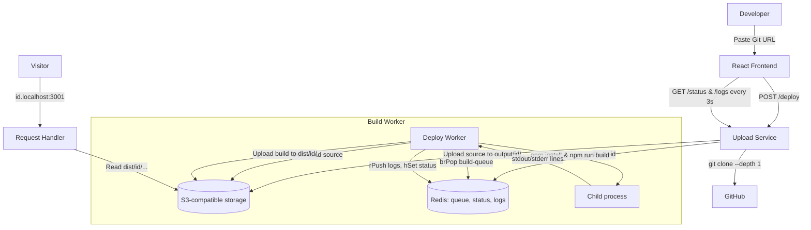

# DeployX

DeployX is a Vercel/Netlify-style deployment platform for frontend projects. Paste a public GitHub repository URL, and DeployX clones it, builds it in a background worker, streams the build logs to a dashboard, and serves the finished site on its own subdomain.

> Based on [Deploy_X](https://github.com/bharath200415/Deploy_X) by bharath200415. This version is extended with S3-compatible local storage (no cloud account needed), app-folder detection for multi-folder repos, S3 pagination, clone timeouts, SPA route fallback, and other reliability fixes. See [What I changed](#what-i-changed).

---

## How it works

Three phases: **Upload → Build → Serve**.



1. **Upload** — The frontend sends the repo URL to the Upload Service, which generates a short ID (e.g. `c9j43`), shallow-clones the repo, uploads the source (minus `.git` and `node_modules`) to `output/<id>/` in storage, sets status `uploaded`, and pushes the ID onto the Redis `build-queue`.
2. **Build** — The worker waits on the queue with `brPop`. It downloads the source, finds the folder whose `package.json` has a `build` script, runs `npm install` and `npm run build`, streams every output line to `logs:<id>` in Redis, and uploads the output folder (`dist/`, `build/` or `out/`) to `dist/<id>/`. Repos without a build script are deployed as static sites if they contain an `index.html`.
3. **Serve** — The Request Handler reads the deployment ID from the subdomain (`c9j43.localhost:3001`) and serves the matching files from storage, falling back to `index.html` for single-page-app routes.

---

## Project structure

| Folder | What it does | Port |
|---|---|---|
| `frontend/` | React 19 + Vite dashboard: submit a repo, watch live logs, get the link | 5173 |
| `uploadService/` | Express API: `POST /deploy`, `GET /status`, `GET /logs`, `GET /health` | 3000 |
| `deployService/` | Background build worker (Redis queue consumer) | — |
| `reqHandler/` | Serves deployed sites by subdomain | 3001 |

**Tech stack:** React 19, Vite, TailwindCSS, Node.js, Express, TypeScript, Redis, AWS SDK (S3), simple-git, Docker.

---

## Local setup

### Prerequisites
- Node.js 20+
- Docker Desktop

### 1. Start Redis and storage (Docker)

```bash
docker run -d --name deployx-redis -p 6379:6379 redis:latest

docker run -d --name deployx-s3 -p 9090:9090 \
  -e COM_ADOBE_TESTING_S3MOCK_STORE_INITIAL_BUCKETS=deployx \
  -e COM_ADOBE_TESTING_S3MOCK_STORE_RETAIN_FILES_ON_EXIT=true \
  -e COM_ADOBE_TESTING_S3MOCK_STORE_ROOT=/data \
  -v deployx-s3-data:/data adobe/s3mock
```

[S3Mock](https://github.com/adobe/S3Mock) is a free S3-compatible server, so no cloud account is needed. Next time, just run `docker start deployx-redis deployx-s3`.

### 2. Create `.env` files

Create a `.env` file in `uploadService/`, `deployService/` and `reqHandler/`:

```env
ACCESS=local
SECRET=local
ENDPOINT=http://localhost:9090
BUCKET=deployx
REDIS_URL=redis://127.0.0.1:6379
```

To use Cloudflare R2 or AWS S3 instead, replace `ACCESS`, `SECRET`, `ENDPOINT` and `BUCKET` with your real values. No code changes are needed.

### 3. Start the backend services (one terminal each)

```bash
cd uploadService && npm install && npm run build && node dist/index.js
cd deployService && npm install && npm run build && node dist/index.js
cd reqHandler    && npm install && npm run build && node dist/index.js
```

### 4. Start the frontend

```bash
cd frontend
npm install
npm run dev
```

Open http://localhost:5173/deploy, paste a public GitHub repo URL (for example `https://github.com/octocat/Spoon-Knife`) and click **Deploy**. When it finishes, open `http://<id>.localhost:3001/`.

Optional `frontend/.env` overrides:

```env
VITE_BACKEND_UPLOAD_URL=http://localhost:3000
VITE_DEPLOY_DOMAIN=localhost:3001
```

---

## What I changed

Starting from the original project, I found and fixed these issues while getting it to run end to end:

| Problem | Fix |
|---|---|
| Bucket name hard-coded in the worker and request handler | Read `BUCKET` from `.env` everywhere |
| Files inside folders failed to download (file opened before its folder existed) | Create the folder first; download errors now fail the deployment instead of hanging |
| Only the first 1000 files were downloaded | Paginate S3 listings with continuation tokens |
| Repos with the app in a subfolder were deployed as raw source | Breadth-first search for the folder with a `build` script |
| Only `dist/` was supported | Detect `dist/`, `build/` or `out/` |
| `git clone` could hang forever on a slow network | 2-minute stall timeout, with `--progress` so slow-but-working clones continue |
| `.gitignore` and `.github` were skipped on upload | Skip only exact `.git` / `node_modules` folders |
| Upload failures never reached the dashboard | Status set to `failed` and an error returned |
| Direct visits to routes like `/about` returned 404 | SPA fallback to `index.html` |
| Missing content types for fonts, `.webp`, video | Added common MIME types |
| Required a paid cloud storage account | Path-style S3 config so it works with local S3Mock as well as R2/AWS |

---

## Notes and limitations

- DeployX hosts **frontend/static sites only**. Backends that need an always-running server (Express, MongoDB, etc.) are not supported.
- Builds run directly on the host machine. Running each build in an isolated container is the main planned improvement.
- Logs are kept in Redis for one hour after a deployment finishes.
- In production, point a wildcard DNS record (`*.yourdomain.com`) at the request handler.
